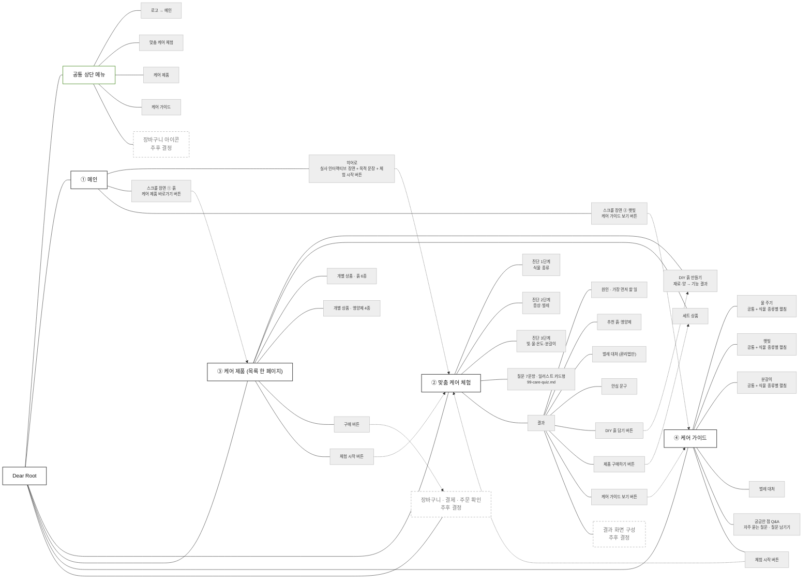

# Dear Root 사이트맵

> 기준 문서: 01-site-purpose.md, 02-site-structure.md, 99-care-quiz.md

## Figma

- 파일: [디어루트](https://www.figma.com/design/7uaKhYiWOTXYevNRtDM7D3/%EB%94%94%EC%96%B4%EB%A3%A8%ED%8A%B8?node-id=0-1)
- 페이지: `Sitemap`
- 프레임 이름: `Sitemap - Dear Root`
- 프레임 링크: https://www.figma.com/design/7uaKhYiWOTXYevNRtDM7D3/%EB%94%94%EC%96%B4%EB%A3%A8%ED%8A%B8?node-id=4-3

## 표기 규칙

| 구분 | 표시 |
|---|---|
| 페이지 | 흰색 실선 박스 |
| 공통 상단 메뉴 | 녹색(#5E993E) 실선 박스 — 별도 페이지가 아니라 모든 페이지 상단에 붙는 내비게이션 버튼 묶음 |
| 페이지 내부 섹션 | 연회색 작은 박스 |
| 추후 결정 항목 | 점선 박스 + "추후 결정" 표시 |
| 계층 연결 | 실선 연결선 (왼쪽 → 오른쪽) |
| 페이지 간 이동 | 버튼 이름 뒤 "→ 목적지" 표시 (아래 Mermaid 계층도에서는 점선 화살표) |

## 가로 계층도

## 계층 목록

- **Dear Root**
  - **공통 상단 메뉴** (별도 페이지 아님, 모든 페이지 상단의 내비게이션): 로고(→ 메인) / 맞춤 케어 체험 / 케어 제품 / 케어 가이드 / ┄장바구니 아이콘 (추후 결정)┄. 로고 왼쪽 · 메뉴 3개 가운데 · 장바구니 아이콘 오른쪽 (출처: 02-site-structure.md)
  - **① 메인** (출처: 02-site-structure.md, 05-site-reference.md)
    - 히어로: 실사 식물이 화면을 채우고 잎이 마우스를 가까이 따라 흔들리는 인터랙티브 장면 위에 목적 문장, 안심 문구, 체험 시작 버튼(→ ② 맞춤 케어 체험)
    - 스크롤 장면 ① 흙: 배경이 최소한으로 아래로 움직여 흙이 보임, 케어 제품 바로가기 버튼 → ③ 케어 제품
    - 스크롤 장면 ② 햇빛: 배경이 최소한으로 위로 움직여 햇빛이 듦, 케어 가이드 보기 버튼 → ④ 케어 가이드
  - **② 맞춤 케어 체험** (출처: 01-site-purpose.md, 02-site-structure.md)
    - 진단 1단계: 식물 종류 (실내 화분 전반)
    - 진단 2단계: 증상·벌레
    - 진단 3단계: 빛·물·온도·분갈이
    - 질문 7문항, 일러스트 카드형 (출처: 99-care-quiz.md)
    - 결과
      - 원인 · 가장 먼저 할 일
      - 추천 흙·영양제
      - 벌레 대처 (관리법만, 벌레 관련 상품은 팔지 않음)
      - 안심 문구
      - DIY 흙 담기 버튼 → ③ 케어 제품 · DIY 흙 만들기
      - 제품 구매하기 버튼 (결과 내용 뒤에 배치) → ③ 케어 제품 · 세트 상품
      - 케어 가이드 보기 버튼 → ④ 케어 가이드
      - ┄결과 화면 구성 (추후 결정, 초안은 04-site-wireframe.md)┄
  - **③ 케어 제품** — 하위 페이지 없이 목록 한 페이지 (출처: 02-site-structure.md)
    - DIY 흙 만들기: 재료를 골라 담으면 배합의 기능 결과 표시. 맞춤 케어 다음가는 두 번째 아이덴티티라 맨 위에 배치 (출처: 99-care-quiz.md)
    - 세트 상품
    - 개별 상품: 흙 6종
    - 개별 상품: 영양제 4종
    - 구매 버튼 (지금은 버튼까지만)
    - 체험 시작 버튼 → ② 맞춤 케어 체험
  - **④ 케어 가이드** — 한 페이지 섹션 구성 (출처: 02-site-structure.md)
    - 물 주기 · 햇빛 · 분갈이: 각각 공통 요령 + '식물 종류별로 보기' 펼침 · 접힘 (6종, 체험 Q1과 같은 분류)
    - 벌레 대처 (출처: 99-care-quiz.md)
    - 궁금한 점 Q&A: 가이드를 읽어도 모르겠는 사람을 위한 자주 묻는 질문과 질문 남기기
    - 체험 시작 버튼 → ② 맞춤 케어 체험
  - ┄**장바구니 · 결제 · 주문 확인 (추후 결정)**┄ — 시간이 남으면 진행 (출처: 02-site-structure.md)

## 추후 결정

- 결과 화면의 구성
- 장바구니 · 결제 · 주문 확인 (그전까지는 구매 버튼까지만)
- 장바구니 아이콘 노출 여부
- Q&A 질문의 답변 방식 (질문을 받는 곳, 답변 방법)
- 반응형 대응 범위 (데스크탑 기준은 확정)
